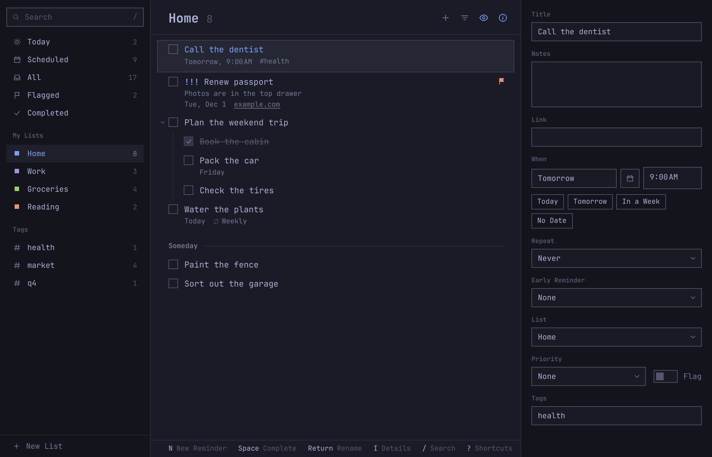
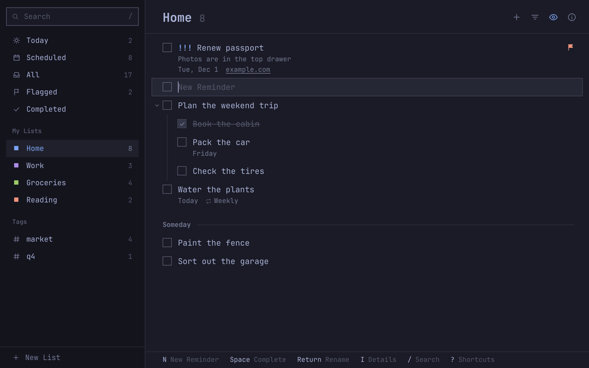
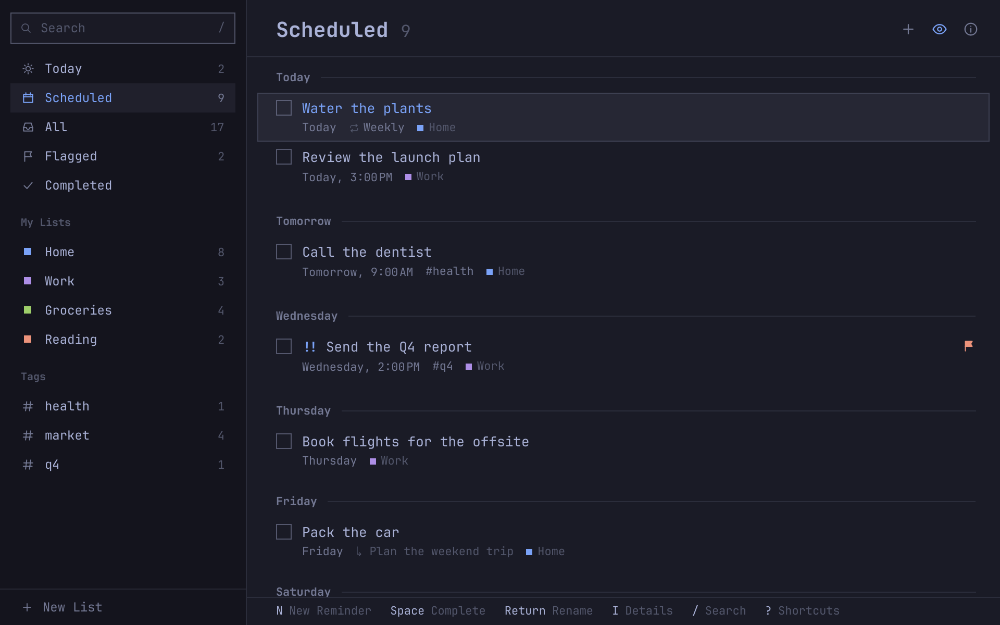
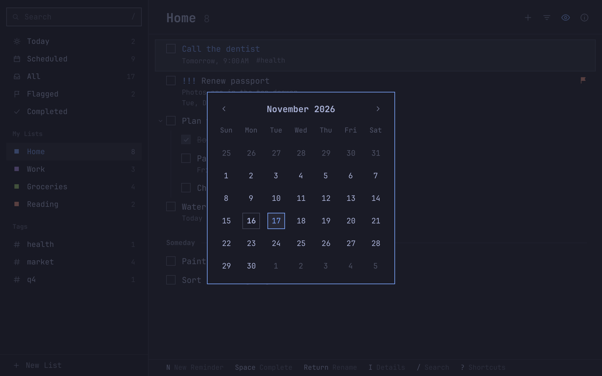
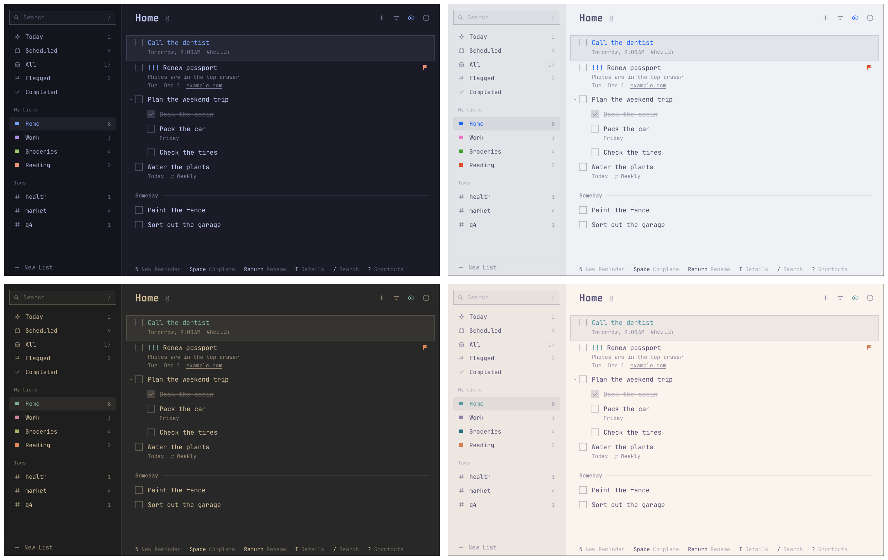

# Nudge

Nudge is a reminders app for Omarchy: lists, due dates and repeats, driven
from the keyboard, with a notification when something is due. Type
`Call the dentist tomorrow at 9 #health` and it files the date, the time and
the tag. Everything stays in one file on your computer, and there is no
account.

[Install](#install) · [Guide](docs/guide.md) · [Changelog](CHANGELOG.md) · [Releases](https://github.com/willykev/nudge/releases)



## Features

- **Type the date.** `Call the dentist tomorrow at 9 #health !!` becomes a
  title, a date, a time, a tag and a priority as you type.
- **Lists that hold real projects.** Sections inside a list, subtasks under
  any reminder, and a color for each list.
- **One place for what is due.** Today, Scheduled and Flagged gather
  reminders from every list, and each tag has a view of its own.
- **Repeats and early reminders.** Daily, weekdays, weekly, monthly, yearly,
  or every few of those, with an alert ahead of time if you want one.
- **Alerts you can answer.** A notification with buttons to complete the
  reminder, or to be reminded in an hour or tomorrow.
- **Keyboard first.** Every action has a key, `?` shows them all, and undo
  covers everything, including deleting a whole list.
- **Looks like your desktop.** Colors, font and corners come from your
  Omarchy theme, light or dark, and change when it does.

## Install

Nudge runs on Omarchy and Arch Linux, on x86_64 and ARM64.

```sh
git clone https://github.com/willykev/nudge.git
cd nudge
bin/install
```

This builds an Arch package and installs it, asking for your password once.
The package is named `nudge-reminders`; the command is `nudge`. Then open
**Nudge** from the app launcher, or run `nudge open`.

Alerts arrive while the window is open. To get them when it is closed too,
press **B** in the window or run:

```sh
nudge background on
```

On ARM64 you can skip the build. Download
`nudge-reminders-*-aarch64.pkg.tar.xz` from the
[latest release](https://github.com/willykev/nudge/releases/latest) and
install it:

```sh
sudo pacman -U nudge-reminders-*-aarch64.pkg.tar.xz
```

On Arch Linux without Omarchy, install what the build needs first:

```sh
sudo pacman -S --needed base-devel git qt6-base qt6-declarative qt6-svg qt6-wayland
```

To update, run `git pull` and `bin/install` again. To remove Nudge, run
`nudge background off` and then `sudo pacman -R nudge-reminders`; your
reminders are left where they are.

## Make your first reminder

Press **N**, type `Call the dentist tomorrow at 9 #health`, and press
**Enter**. Nudge reads the date, the time and the tag out of the words and
shows what it read under the line as you type. Enter saves the reminder and
starts the next, so a list can be written out one line after another; **Esc**
stops.



### See the week ahead

**Scheduled** lays out everything that has a date, day by day, whichever
list it is in. **Today** and **Flagged** do the same for what is due now and
what you marked. `←` moves to the sidebar, and `↑` and `↓` choose a view.



### Set a date without typing it

`T` makes the selected reminder due today, `Shift+T` tomorrow, and `W` in a
week. `D` takes a date in the same words you would type in a title, and the
details (`I`) have a calendar, repeats and an early reminder.



### Change the theme, and Nudge changes with it

Nudge has no colors or fonts of its own. A list is colored by name, so it
takes on each theme's own blue or green, and checkboxes and dialogs are
square where your windows are square.



### Keys worth knowing

| Key | Does |
| --- | --- |
| `N` | New reminder |
| `Space` | Complete or reopen |
| `Return` | Rename |
| `I` | Show or hide details |
| `Tab` / `Shift+Tab` | Make a subtask / back to a reminder of its own |
| `T` / `Shift+T` / `W` | Due today / tomorrow / in a week |
| `F` | Flag |
| `1` `2` `3` `0` | Priority: low, medium, high, none |
| `M` | Move to another list |
| `/` | Search |
| `Ctrl+Z` / `Ctrl+Shift+Z` | Undo / redo |
| `?` | Show every shortcut |

The [guide](docs/guide.md#shortcuts) lists every key.

## Use the terminal

Reminders can be added, listed and completed from the terminal. If the
window is open, it shows the change at once.

```sh
nudge add "Water the plants every friday"        # typed dates work here too
nudge add "Renew passport" --due 2026-12-01 --list Home --flag
nudge list today                                 # what is due
nudge done 3                                     # complete a reminder by its number
nudge export backup.json                         # everything, as JSON
```

Run `nudge help` for every command, and add `--json` for scripts.
`nudge skill install` teaches coding agents to keep your reminders for you.

## Performance

- The window is ready about 0.15 seconds after launch, and about 0.18
  seconds with 10,000 reminders in it.
- `nudge add` takes about 25 ms. With 10,000 reminders it takes about 35 ms,
  and `nudge list today` about 50 ms.
- 10,000 reminders fit in a file of 0.9 MB.
- The background service sleeps until a reminder is due, waking once a
  minute to check the clock.
- The package is under 300 KB.

Measured on an Apple M3 Max running Asahi Linux and Qt 6.12, off screen.
Window times are how long `nudge open --screenshot shot.png` takes beyond
the 0.9 seconds it waits before taking its picture.

## Your data

Reminders live in `~/.local/share/nudge/nudge.db`, a SQLite file written on
every change. `nudge export` writes everything as JSON and `nudge import`
reads it back, for backups or for moving to another computer.

Nudge makes no network connections. There is no sync between devices and no
sharing of lists, and typed dates are read in English.

## More

The [guide](docs/guide.md) covers every shortcut and command, alerts while
the window is closed, and
[what Nudge does not do](docs/guide.md#what-it-does-not-do). See the
[changelog](CHANGELOG.md) for what is new, and
[CONTRIBUTING](CONTRIBUTING.md) to build, test or change Nudge.

[MIT license](LICENSE), with acknowledgments to the upstream projects.

[](https://github.com/willykev/nudge/actions/workflows/build.yml)
